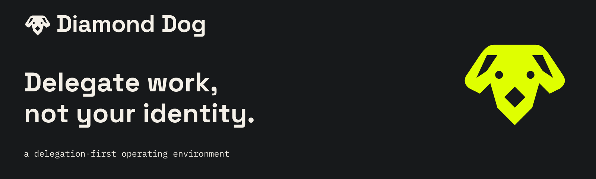

# Diamond Dog

**Delegate work, not your identity.**

The coming-soon website and first-edition brand kit for Diamond Dog, a delegation-first operating environment.

This repository is separate from [the OrcaOS tool](https://github.com/Orca-Solutions/OrcaOS). It contains no runtime implementation. The product is in early design, with a first experiment under way; nothing has shipped yet.

## Contents

- `site/` — portable static website, including local fonts and images.
- `brand-kit/` — 22-page brand book, SVG/PNG logos, mascot, font licenses, design tokens, applications, and voice guidance. Start with `brand-kit/START-HERE.txt`.
- `tools/stamp_assets.py` — run it after editing `site/styles.css` or `site/script.js`. It stamps their links in `index.html` with a content hash (`styles.css?v=…`), so browsers and the host's cache never pair a new page with an old stylesheet.
- `tools/art/` — optional Python generators for the computed spot art (the collar dogs and the looping receipt); their output is committed inline in `site/index.html`.
- `WORKING_RECORD.md` — decisions, verification, and current delivery state.

## Preview locally

From the repository root:

```sh
python3 -m http.server 4173 --bind 127.0.0.1 --directory site
```

Open `http://127.0.0.1:4173`. There is no dependency installation or build step. The page is HTML/CSS with a small JavaScript interaction explaining evidence labels. FAQ sections use native HTML disclosure controls.

The page has no signup collection, analytics, cookies, backend, or account integration. The sample receipt is illustrative, not a product screenshot or a shipped workflow.

## Hosting

The public production target is **https://diamonddog.orcasolutions.dev/**, using
a separate Cloudflare Pages project named `diamonddog`. Only `site/` is served;
the brand kit and repository documents stay outside the web root.

Cloudflare configuration: Git source `Orca-Solutions/diamond-dog-landing`,
production branch `main`, repository root, build command `exit 0`, output `site`.
No dependency installation, application secret, backend or storage binding is
needed. Once production is activated, pushes to `main` deploy automatically;
other branches produce previews. An exact build/deployment receipt and the
current activation status belong in the [DevOps hosting record](https://github.com/Orca-Solutions/dev-ops/blob/main/deployments/diamonddog/README.md).

PRs should show a clickable Cloudflare preview comment. Cloudflare's native
comment can be missing when the branch finished building before its PR opened.
`.github/workflows/preview-link.yml` fills that gap on PR creation and Cloudflare
check completion. It reads the successful check's exact deployment and current
PR commit, preserving a native comment when one already exists. A fallback
comment updates on subsequent commits and clears an old link while a new
preview is pending or failed. It uses only the temporary GitHub token with
checks-read and PR-comment permissions; no checkout, Cloudflare token, new
build or production deployment is involved. Fork PRs are excluded.

Check the link handler locally with `node --test tools/preview-link.test.mjs`.
The completed-check/manual triggers become active once this workflow is on
`main`; the PR trigger also verifies the candidate workflow before merge.

The earlier owner-private review deployment remains on ChatGPT Sites:

https://diamond-dog-coming-soon.ninjasoforca.chatgpt.site

That review deployment uses a separate Sites-managed source mirror; GitHub pushes
do not update it. Production's canonical and Open Graph URLs use the public
custom domain. Keep them aligned if the production hostname changes.

To update the private review, copy the approved `site/` contents into the existing
Sites project's static directory and publish through its supported workflow.
For production recovery, roll back to a previously accepted Pages deployment,
then restore the corresponding source through the normal repository workflow.
There is no database or user-submitted state to migrate.

## Brand and licensing

The selected logo has symmetrical ears. The black editorial dog has a narrow acid collar and a lilac diamond tag. The original reference photograph is excluded.

The brand book is the v1 design handoff; its landing-page concept is a historical concept, while `site/` is the implemented website. No changes are made to the tool's fixed inspector test screens.

Font license notices are included beside the font files. A brand-asset usage policy and a license for this website's source have not been selected. The tool's proposed software licenses do not automatically license these assets. The name and mark have not been cleared for public use. Allan Peters and Wharton did not participate in or endorse this work.

## Shared project instructions

[AGENTS.md](AGENTS.md) and [CLAUDE.md](CLAUDE.md) are matching, tracked entry points for local and cloud agents. Keep personal overrides in ignored `CLAUDE.local.md`.
